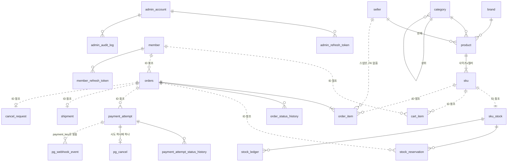

# ERD 초안 (R1 범위)

- **상태**: 초안(R0-06, 이슈 #53). 실제 테이블은 R1 작업의 Flyway 마이그레이션이 만든다. 마이그레이션이 생기면 테이블 정의서(작업진행.md A7, `information_schema` 덤프)가 이 문서를 대신하고, 이 문서는 그림과 "왜"만 남긴다.
- **근거**: 작업진행.md B2~B8, ADR-001·003·004·005·006a·006b·008·010. 모듈 제목 옆의 ADR이 그 모듈 테이블의 근거다. 칼럼 옆 **(초안)** 은 ADR·B에 근거가 없어 이 문서가 처음 제안하는 칼럼이라 해당 R1 작업에서 확정한다. 근거가 있는 칼럼도 **이름**은 이 문서가 처음 붙인 것이라 R1 작업에서 바뀔 수 있다.
- **R2b 이후**(쿠폰, 부분취소·반품, 드롭, 판매자주문, 정산, Outbox)의 테이블은 넣지 않았다. 판매자주문 계층과 관련 칼럼은 R4 전에 미리 만들지 않는다(ADR-003 결정 4).

## 공통 규약 (ADR-010)

| 항목 | 규칙 |
|---|---|
| 내부 PK | `id BIGINT AUTO_INCREMENT`. 밖으로 내보내지 않는다 |
| 외부 ID | 주문번호 `order_no`, 결제 시도 `attempt_uid`, 취소 `pg_cancel.uid`: `CHAR(36)` UUIDv4, 유니크 |
| 금액 | 원 단위 `BIGINT`. 소수 타입 금지(R0-06 ArchUnit이 코드에서도 막는다) |
| 시간 | UTC `DATETIME(6)` |
| 상태 | `VARCHAR`. 허용 값은 아래 상태 표와 ADR-004·006a·006b |
| 모듈 사이 | **FK를 걸지 않고 ID로만 참조한다**(ADR-001). 그림에서 점선 |
| 원장 | `stock_ledger`, `order_status_history`, `admin_audit_log`는 추가만 한다 |

## 그림

실선은 같은 모듈 안의 FK, 점선은 다른 모듈을 ID로만 가리키는 참조(FK 없음)다.

## 테이블 (모듈별)

### catalog
| 테이블 | 칼럼 | 제약·메모 |
|---|---|---|
| `seller` | id, name, created_at | R1~R3은 "직매입 자사" 한 행(시드). catalog가 소유하고 R4에 seller 모듈로 패키지만 옮긴다(ADR-003 결정 1) |
| `brand` | id, name (초안) | 가상 브랜드 20~50개(R0-09) |
| `category` | id, parent_id, name, sort_order (초안) | 트리. 깊이·속성 표현은 R0-09 시드 생성기에서 정한다 |
| `product` | id, seller_id(FK, 현재 판매자, ADR-003), brand_id, category_id, name, price, sale_status, created_at (초안) | 가격·판매 상태는 주문 때 order가 원본으로 다시 확인한다(B0-2) |
| `sku` | id, product_id, size, color, sku_code (초안) | 유니크 `(product_id, size, color)`, `sku_code` |

### inventory (ADR-005)
| 테이블 | 칼럼 | 제약·메모 |
|---|---|---|
| `sku_stock` | sku_id(PK), available, reserved, on_hand | CHECK `available >= 0`, `reserved >= 0`, `on_hand - available - reserved >= 0`(I1). 예약은 `WHERE available >= n` 조건부 UPDATE |
| `stock_reservation` | id, order_id, sku_id, qty, status, expires_at, created_at (created_at은 초안) | 상태 `ACTIVE → RELEASED \| CONSUMED` 한 번만(I3). 재예약은 새 `ACTIVE` 행 |
| `stock_ledger` | id(초안), sku_id, d_available, d_reserved, d_on_hand, reason, ref_type, ref_id, created_at | 추가만. 유니크 `(ref_type, ref_id, reason, sku_id)`: 같은 근거로 두 번 기록하지 못한다(취소 복구 정확히 한 번, B6). SKU별 합계 = `sku_stock`(I2) |

### cart
| 테이블 | 칼럼 | 제약·메모 |
|---|---|---|
| `cart_item` | id, member_id, sku_id, quantity, created_at (초안) | 유니크 `(member_id, sku_id)`. 배송비 규칙은 두지 않는다(ADR-003 결정 3) |

### order (ADR-003·004·005·006a)
| 테이블 | 칼럼 | 제약·메모 |
|---|---|---|
| `orders` | id, order_no(UUIDv4), member_id, status, current_attempt_id(ADR-006a), shipping_fee(ADR-003), total_amount, payment_expires_at(ADR-005·006a), status_changed_at(ADR-006b), created_at, updated_at (created_at·updated_at은 초안) | `order`는 SQL 예약어라 `orders`로 쓴다(초안). `total_amount = Σ order_item.payment_amount + shipping_fee`(I8). 받는 사람 이름·연락처·주소는 아래 "개인정보" |
| `order_item` | id, order_id, sku_id, seller_id(스냅샷, FK 없음), product_name, option_name, unit_price, quantity, discount_amount, payment_amount | **생성 뒤 바뀌지 않는다**(B2, R0-06 ArchUnit). `discount_amount`는 R2b 쿠폰 안분부터 값이 생긴다. R1에 미리 둘지(기본값 0)는 R1-06에서 정한다(초안). 상태 칼럼과 `seller_order_id`는 두지 않는다(ADR-003 결정 4) |
| `order_status_history` | id, order_id, from_status, to_status, cause, actor_type, actor_id, created_at | 추가만(ADR-004 규칙 5). 주체는 ID만 남기고 이름·연락처는 남기지 않는다. I6 검사가 읽는다 |

### payment (ADR-006a·006b)
| 테이블 | 칼럼 | 제약·메모 |
|---|---|---|
| `payment_attempt` | id, attempt_uid(UUIDv4, 토스 orderId), order_id, amount, status, payment_key, failure_code, pg_version, method, approved_at, status_changed_at, created_at | 유니크 `attempt_uid`, `payment_key`(NULL 허용). 멱등키 `confirm-{attempt_uid}`. 카드번호 등은 저장하지 않는다. method·approved_at은 ADR-006a "응답 중 쓰는 필드"를 칼럼으로 적은 것(초안) |
| `payment_attempt_status_history` | id, attempt_id, from_status, to_status, cause, created_at | 추가만. ADR-006a 결정 2 "전이 규칙(잠금, 표 한 곳, 멱등, **이력**)은 ADR-004와 같다"에서 온 테이블이다. 칼럼은 `order_status_history`와 같은 모양(초안). 같은 모듈이라 `attempt_id`는 FK |
| `pg_cancel` | id, uid(UUIDv4), attempt_id, source(`CUSTOMER`·`COMPENSATION`), amount, status, requested_at, canceled_at, status_changed_at | 유니크 `uid`, `attempt_id`(R1은 시도 하나에 취소 하나, ADR-006b 결정 3). 멱등키 `cancel-{uid}`. 같은 모듈이라 `attempt_id`는 FK |
| `pg_webhook_event` | id, payment_key, status, pg_created_at, event_type, received_at, processed_at (received_at·processed_at은 초안) | 유니크 `(payment_key, status, pg_created_at)`(ADR-006b 결정 5의 `created_at`). 이름을 `pg_created_at`으로 바꿔 행을 만든 시각과 헷갈리지 않게 했다(초안). 토스의 `createdAt`(한국 시각, 시간대 표시 없음)을 Asia/Seoul로 해석해 UTC로 저장 |

### shipping
| 테이블 | 칼럼 | 제약·메모 |
|---|---|---|
| `shipment` | id, order_id, carrier, tracking_no, status, last_synced_at, created_at (초안) | 유니크 `order_id`(R1은 주문 하나에 배송 하나). 역방향 상태는 무시하고 마지막 갱신 시각을 보여 준다(B7) |

### claim (ADR-004 RP-4 답, B6)
| 테이블 | 칼럼 | 제약·메모 |
|---|---|---|
| `cancel_request` | id, order_id, member_id, reason, requested_at, refunded_at (초안) | 유니크 `order_id`(R1은 출고 전 전체취소만). `requested_at`이 환급 기한(3영업일, 전자상거래법 제18조 ②)의 기산점. PG 키와 PG 응답은 payment의 `pg_cancel`이 담는다. `refunded_at`은 claim 작업자가 payment 공개 API로 받은 `pg_cancel.canceled_at`을 옮겨 적은 값이다(ADR-006b 결정 4 "환급 완료 시각"). claim은 payment 테이블을 읽지 않으므로 기한 검사는 이 칼럼으로 한다. 두 값이 다르면 I5 대사(R1-18)가 잡는다 |

### member (ADR-008)
| 테이블 | 칼럼 | 제약·메모 |
|---|---|---|
| `member` | id, email, password_hash, name, created_at (초안) | 유니크 `email`. 비밀번호는 Spring Security 위임 인코더 해시 |
| `member_refresh_token` | id, member_id, family_id, token_hash, expires_at, used_at, revoked_at, created_at (초안) | 토큰 값은 SHA-256 해시만 저장(ADR-008 결정 3). 유니크 `token_hash`. 이미 쓴 토큰이 다시 오면 같은 `family_id`를 모두 폐기 |

### admin (ADR-008)
| 테이블 | 칼럼 | 제약·메모 |
|---|---|---|
| `admin_account` | id, login_id, password_hash, created_at (초안) | 유니크 `login_id`. API로 만들 수 없고 서버 명령으로만 만든다(S2) |
| `admin_refresh_token` | `member_refresh_token`과 같은 모양, admin_id | 고객 토큰과 테이블을 나눈다(ADR-008 결정 1) |
| `admin_audit_log` | id, admin_id, action, target_type, target_id, created_at (초안) | 추가만 |

로그인 실패 횟수는 테이블이 아니라 Redis에 센다(ADR-008 결정 7).

## 개인정보 (A5-10)

| 어디 | 무엇 | 처리 |
|---|---|---|
| `member` | 이메일, 이름 | 로그 마스킹. 암호화 여부는 R1-19(민감정보 암호화)에서 정한다(미정) |
| `orders`의 받는 사람 칼럼(초안: recipient_name, recipient_phone, zip_code, address_line1, address_line2) | 이름, 연락처, 주소 | 주문 시점 스냅샷. "민감정보는 암호화"(A5-10)를 어디까지 적용할지는 R1-19에서 정한다(미정) |
| 비밀번호, 리프레시 토큰 | | 해시만 저장. 평문은 저장하지 않는다 |

## 이 초안에서 정하지 않은 것

- 인덱스(조회 조건이 정해지는 R1 각 작업에서), 칼럼 길이, 상태 칼럼의 CHECK 제약 여부.
- 상품 속성(PLP 필터) 표현: R0-09 시드 생성기와 R1 목록 작업에서.
- 개인정보 암호화 범위: 위 표.
- **R1에서는 다시 취소할 수 없다**: `cancel_request.order_id`와 `pg_cancel.attempt_id`가 유니크라서, 취소가 명확히 실패해 `PAID`로 돌아간 주문에 두 번째 취소 기록을 만들 수 없다. R1에는 취소의 명확한 실패가 없어 이 전이가 일어나지 않는다(ADR-006b 결정 3). 실패 코드를 실측해 이 전이가 생기면(R2a) 유니크 범위를 다시 정한다.
- `cancel_request`의 상태 칼럼: 취소 진행 상태는 주문 상태(`CANCEL_REQUESTED`)가 맡는다(ADR-004 RP-4 답). 따로 둘지는 R1-13에서 정한다.
